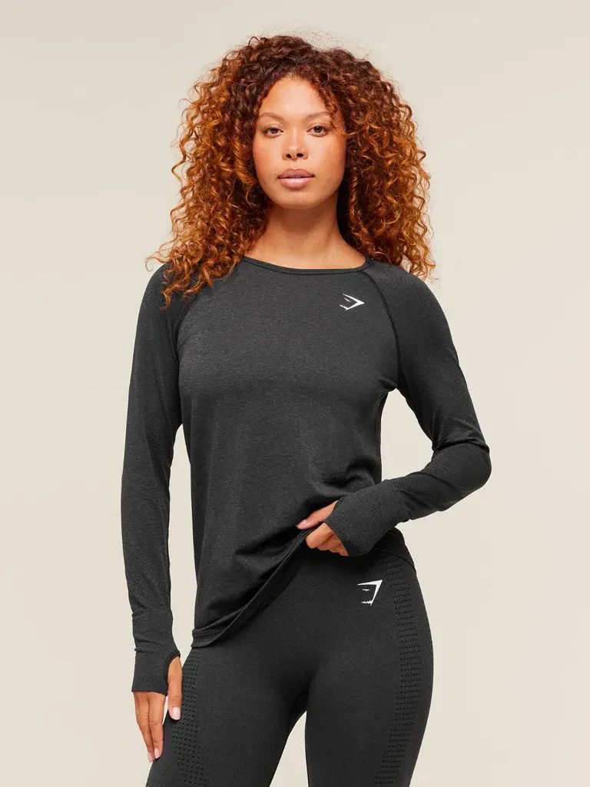
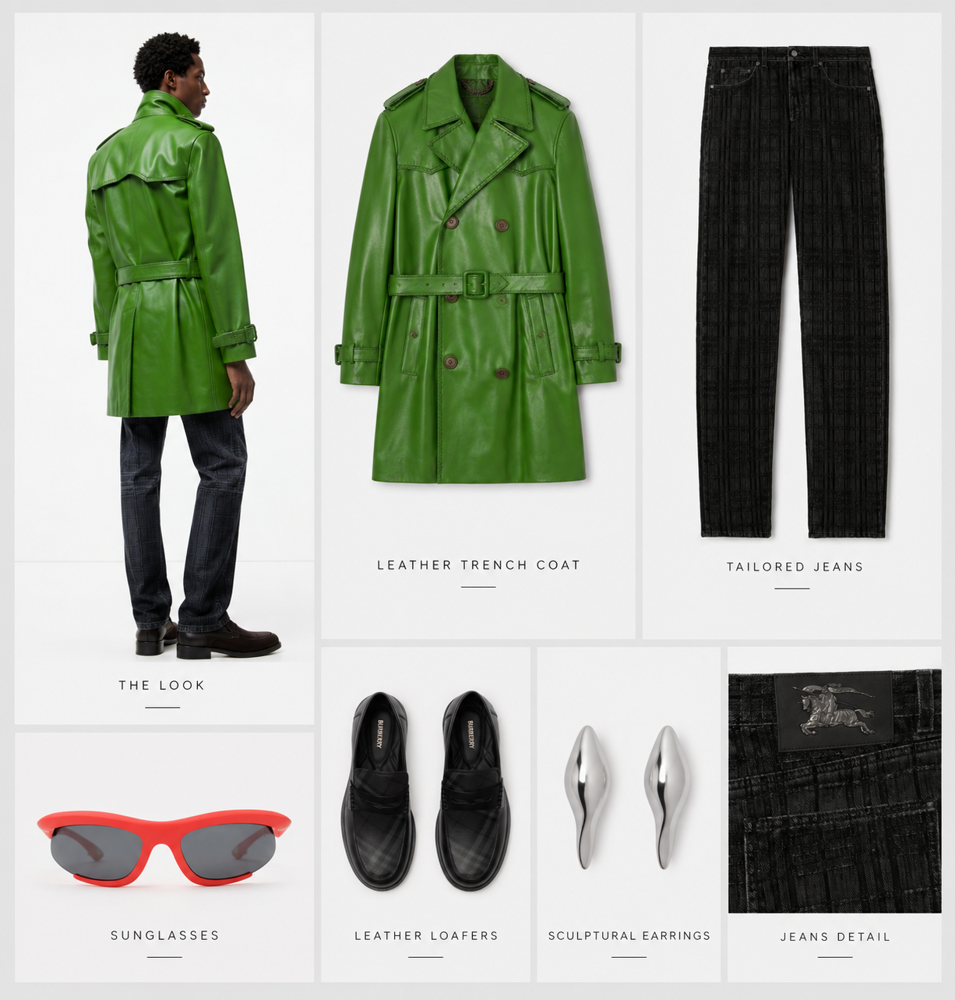

# Velox Developer Hub — DressMe & TriFit

Build virtual try-on into your website, app or retail platform. **DressMe** turns
a shopper photo and a garment image into an AI outfit preview. **TriFit** is
Velox's consumer experience.

This repository is the public home for Velox SDK source, runnable integrations,
tutorials and AI-agent integration skills. Start with the demo, then inspect the
exact SDK implementation behind it.

## Start here

| Want to… | Go here |
| --- | --- |
| Try without an account | [Hosted demo](https://studio.v3lox.com/partners/demo/demo) — free shared, limited queue |
| Try with your own saved photos, products and history | [TriFit app](https://trifit.v3lox.com/) — sign in/create an account and use its available free daily/weekly/monthly allowance |
| See your demo requests and download the SDK ZIP | [Demo dashboard & SDKs](https://studio.v3lox.com/partners/demo/admin) |
| Explore immediately on your computer, without credentials | Download this repository; run `npm run preview` with Node.js 22+ |
| Build a real integration | [Getting started](docs/GETTING_STARTED.md) · [Apply for access](https://studio.v3lox.com/partner-api#apply) |
| Run real DressMe from code with my existing TriFit account, without a partner key | [Example 2: account sign-in](examples/account/README.md) |
| Understand which access route to use | [All DressMe options](docs/DRESSME_ACCESS.md) |
| Read the API flow | [Technical walkthrough](WALKTHROUGH.md) |
| Choose an SDK | [SDK catalogue](docs/SDK_CATALOG.md) |
| Use Codex or GitHub Copilot to build a web/mobile integration | [MCP setup and mobile starter prompt](docs/CODING_AGENTS.md) · [Portable integration skill](skills/velox-partner-api/SKILL.md) |
| Install the published OpenAI Developer plugin | [Velox TriFit Developer](https://chatgpt.com/plugins/plugin_asdk_app_6acded3353148191b15d782c1cc1f458) — read-only API guidance |
| Find the public API overview | [Velox TriFit Partner API](https://studio.v3lox.com/partner-api) |

**Two public pages, not the Velox operator admin.** The dashboard shows only the
visitor's own browser-session requests and public SDK downloads. It exposes no
keys, routing, quota editing, other visitors' photos or traffic-test controls.
Hosted UI updates follow the Studio Development-to-Production release gates;
the public host may run an earlier accepted version than the source you inspect.

## See real public try-on examples

Existing official TriFit examples: AI personal portraits, clothing references and
their actual TriFit outputs. These are historical examples, not mocks, newly run
tests or performance/quality comparisons. [Provenance and media notes](web/samples/README.md).

| Example | Personal photo | Clothing reference | TriFit result |
| --- | --- | --- | --- |
| Amara · activewear |  |  |  |
| Mateo · overshirt |  |  |  |

Try your own photos in the [TriFit app](https://trifit.v3lox.com/) with available
account allowance, or the [shared demo](https://studio.v3lox.com/partners/demo/demo)
without an account. The live host receives UI updates through its separate release.

### Outfit-collage starter products

The demo source includes the **same five clothing collages used in our provider
comparison tests**, copied without image edits. Select a whole board as the product
reference and use a separate personal photo. Reference models inside a board are
not the target person. Accessory transfer and garment fidelity can vary.

| Green trench · details | Green trench · full look | Burgundy trench & skirt |
| --- | --- | --- |
|  |  |  |

| Navy blazer & argyle skirt | Leather jacket & denim |
| --- | --- |
|  |  |

These are product inputs, **not generated result images or proof of provider
rankings**. They are separate from the matched Amara/Mateo examples above.
Brand names within the boards do not imply endorsement.

## Install the Codex plugin

The [Velox TriFit Developer OpenAI listing](https://chatgpt.com/plugins/plugin_asdk_app_6acded3353148191b15d782c1cc1f458)
is published (verified 24 October 2026, version 1.1.2). You can also connect the
public documentation MCP directly in [Codex or Copilot](docs/CODING_AGENTS.md)
without installing the full plugin. Neither route grants live Partner API access.
Registry metadata is being prepared separately; see [publication checklist](docs/MCP_REGISTRY.md).

See [installation and test prompts](https://github.com/Velox-XR/trifit-partner-api-example/blob/main/docs/CODEX_PLUGIN.md). The GitHub marketplace
package is separate from universal directory review and approval.

### Velox TriFit — API guidance and try-on in one plugin

The [Velox TriFit ChatGPT/Codex plugin](https://github.com/Velox-XR/trifit-partner-api-example/blob/main/docs/TRIFIT_PLUGIN.md) combines API guidance
with consented account or guest try-on in one package. The [v1.2.1 Production-targeted source](https://github.com/Velox-XR/trifit-partner-api-example/tree/main/plugins/velox-trifit)
and reproducible ZIP builder are available for inspection. **Production activation
and client acceptance are in progress; this is not yet an invitation to connect
or an approved public-directory listing.** This repository distributes Production
packages only. Private Development packages and connection instructions are not
included. The existing developer package and its OpenAI review remain unchanged.

The candidate also includes [applying by email inside the chat](docs/TRIFIT_PLUGIN.md#apply-for-a-partner-key-without-leaving-chat):
confirm your connected sender mailbox, optionally add project details, then review
and approve the message to **partner@v3lox.com**. No automatic key issuance. This
mailbox workflow still needs an approved end-to-end send/receipt acceptance test.

## One demo, one inspectable SDK integration

The hosted application is this repository's browser UI, demo backend and shared
queue, using [the JavaScript SDK](sdks/javascript/index.mjs). It is not a separate
partner-specific application or a mock presented as real generation.

- Dedicated hosted partner identity: `demo`.
- Real DressMe requests; AnimateMe is not enabled for the public demo.
- Signed, durable webhook completion with delayed GET-only recovery if a callback is missing. The UI labels the actual completion source.
- Total elapsed duration, uploads, demo queue and submission-to-observed-completion timings. These are not GPU-only timings.
- Download one look, or all your latest 25 completed requests, as an asset ZIP containing uploaded inputs, results and a timing/checksum manifest. This is separate from the SDK source ZIP.
- One active generation, and at least **10 seconds between starts**.
- Personal and product uploads overlap, with durable receipts for both assets.
  This removes sequential upload waiting without changing generation quality or
  bypassing the queue and usage limits.
- The dashboard ZIP contains this same public source, SDK, examples and guides.
- No API key is needed to visit the Velox-hosted demo.
- To run your own commercial partner backend, apply for **your own** partner configuration.
- For code using your own TriFit account instead, use [Example 2](examples/account/README.md) without a partner key.

The checked-in [configuration template](partner.config.example.json) identifies
the `demo` integration and Production API URL, but its key is deliberately
invalid and real generation is disabled. **It is not a public API credential.**
The hosted service loads the real key privately on Velox's server. It never
appears in GitHub, JavaScript sent to the browser or public ZIP downloads.

## Run locally

Install Node.js 22 or later. No dependency installation is required:

```sh
npm run preview
```

Open the printed URL. The demo and dashboard work locally; the preview cannot
upload or generate. The dashboard's ZIP download works in preview too.

### Explore the reference workspace

The public workspace follows the fuller partner-demo layout, with a developer
sidebar linking to the public code, SDK ZIP, walkthrough and access application.

- Add up to eight shopper photos and eight product images to **local trays**.
  The source also includes five starter outfit collages from the comparison tests.
  Click one to add it to the product tray without uploading anything.
  Select a pair and inspect it before sending a request. Adding, selecting or
  removing a preview performs no upload or generation.
- JPEG, PNG and WebP photos are prepared locally in the browser: automatically
  resized to at most 2048 pixels on the longest side (never enlarged), with
  aspect ratio and browser-decoded orientation preserved. Your original files
  are untouched; only the prepared copies are submitted. No upload occurs while
  selecting or preparing images. Output stays within the API's 5 MiB cap.
  For browser safety, source files above 32 MiB or 100 megapixels are rejected
  with a prominent error. Unsupported or corrupt files also show clear errors.
- Only an explicit consented submission sends the selected pair. The example
  uploads the pair for each new request; trays are not a persistent asset-ID
  catalogue or a shared partner library.
- Review the request stages, original inputs, completed result and side-by-side
  shopper/result comparison. Local inputs are held only in the open page's memory;
  after reload, request history and available results can be read, not old inputs.
- History shows only this signed browser session's latest 25 requests. Refreshing
  history or checking an uncertain request is read-only and never replays a job.

No production/development selector, shared photo library, routing, webhook
registration or load-test controls are exposed by this public UI. The private
partner workbench is unchanged.

For real **Partner API** access:

1. [Apply through your connected mailbox in the updated plugin](docs/TRIFIT_PLUGIN.md#apply-for-a-partner-key-without-leaving-chat),
   or use the [website form](https://studio.v3lox.com/partner-api#apply).
   In-chat project, expected usage and launch timing details are optional.
2. Velox reviews your request, creates a unique partner integration and emails
   private, environment-specific configuration.
3. Save the supplied `partner.config.json` beside `package.json`.
4. Run `npm start`. Startup verifies the assigned API identity and environment.

For webhook-first completion, ask Velox to grant `webhooks:write` on your own backend
key, then register your public HTTPS receiver:

```sh
node setup-webhook.mjs https://YOUR_HTTPS_HOST/webhooks/dressme
npm start
```

The setup command saves the endpoint ID and signing secret privately in
`partner.config.json`. Hosted mounting prefixes must be included in the callback
URL. See [hosting](docs/HOSTING.md) for the exact origin/proxy contract. With no
webhook configured, the local example remains explicitly polling-only; it does not
claim webhook delivery. The standalone mock remains an unpaid API-flow fixture.

A free TriFit account is not a partner credential, but can authorise the separate
[personal-account example](examples/account/README.md) using its own available
allowance. Real Partner API use can incur charges,
including in Development. Never commit the private configuration or reuse the
Velox-hosted demo key in another deployment.

## Available SDKs

**JavaScript (Node.js) + TypeScript declarations** are available now, under MIT:
[SDK source](sdks/javascript) · [SDK reference](sdks/javascript/README.md).

The runnable demo is one complete integration of this SDK. More language packages,
framework examples and agent guides can be added to this hub; the catalogue lists
only implementations that actually exist. Other languages may use the documented
HTTP API, but are not advertised as downloadable SDKs until shipped and tested.

## Queue, privacy and safe recovery

The 10-second gap is a minimum start interval, not an ETA or performance guarantee.
A job taking longer keeps the active slot until it finishes. One pending request
per visitor and a backlog of 25 bound temporary admission; there is no lifetime
request cap in the example. **Velox API quotas and commercial permissions still
apply.** The newly created hosted partner currently has its default 100/month
allowance; this repository does not silently increase it.

Browser sessions are private, signed and HttpOnly, with Secure cookies on HTTPS.
The dashboard is session-scoped; clearing cookies loses access to that session's
history. A 48-hour cookie expiry is not automatic media deletion. Image consent,
the privacy policy and agreed retention apply.

The local evaluator stores receipts in ignored `.demo-state/`, with a single
exclusive owner. It saves input IDs, idempotency keys and job IDs, not image bytes,
API keys or signed URLs. An uncertain submission pauses the queue; it is never
automatically replayed. After a crash, retain the journal and lock for operator
reconciliation. Do not run multiple copies with the shared demo credential.

See [hosting and release requirements](docs/HOSTING.md) and [security](SECURITY.md).
The queue's rate limit alone is not a financial budget or full bot defence.

## Test without paid API calls

```sh
npm test
npm run demo:mock
npm run demo:failure
```

Tests and explicit mock modes use local fixtures only. They do not read private
configuration or call Velox. A mock result is not a real AI result or latency proof.

## Licence

The **public SDKs, examples, documentation and agent skill** in this repository
are [MIT licensed](LICENSE). This does not license Velox's hosted API service,
private product code, trademarks or customer material. API access and usage remain
subject to separately agreed terms. AI previews are not guarantees of fit, sizing,
colour or garment detail.
